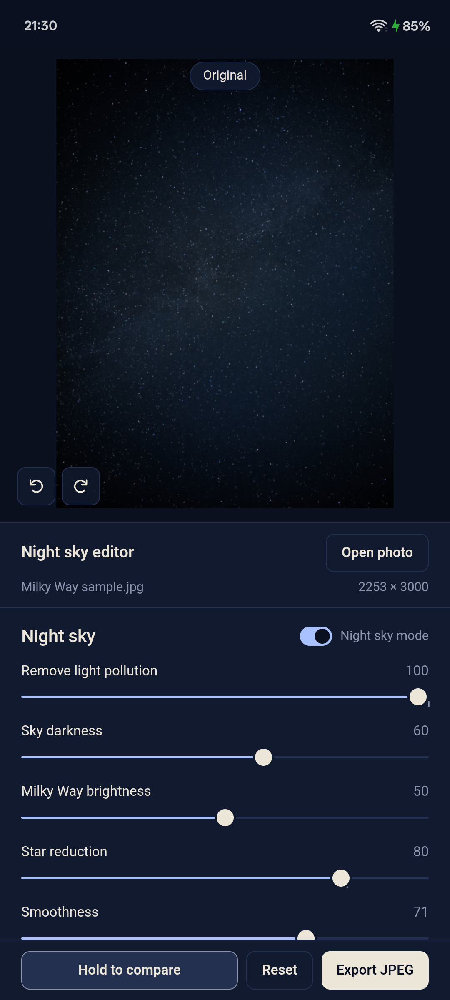
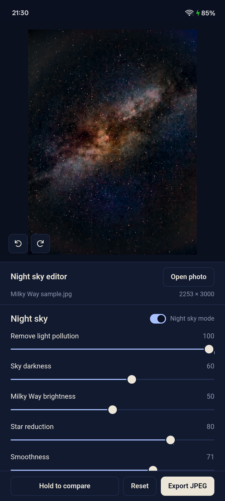
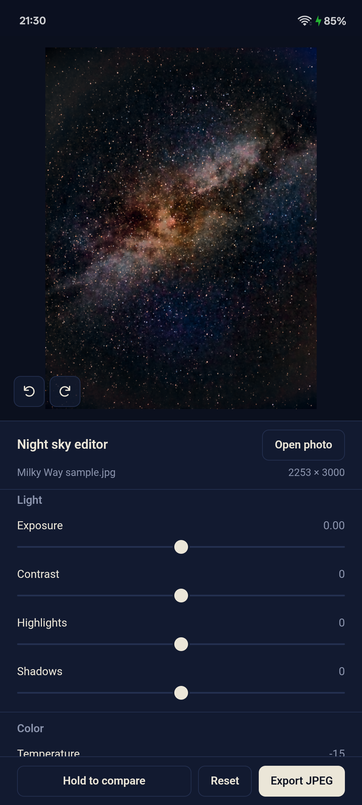

# Night Sky Editor

Bring out the Milky Way in your phone's night photos. Open a raw DNG straight from your phone's
camera (or any JPEG), drag a few sliders, and save the result. Everything runs on your phone:
no account, no ads, no uploads, no internet needed.

  
  
  

## Download (Android 10 or newer)

**[Download NightSkyEditor-1.0.apk](NightSkyEditor-1.0.apk)** (2 MB). On the page that opens,
tap the download button (↓).

1. Open the downloaded APK on your phone.
2. If Android asks, allow your browser (or Files app) to **install unknown apps**.
3. Tap **Install**.

To update later, download the newer APK and install it over the old one.

## What it does

The editor separates the stars from the sky, so each can be adjusted on its own:

- **Remove light pollution**: takes out the orange glow and dark corners
- **Sky darkness** and **Milky Way brightness**: set the background and the band separately
- **Star reduction**: calms the confetti of faint stars so the Milky Way stands out
- **Smoothness**: removes sky noise without blurring the stars (set automatically for noisy raws)
- Exposure, contrast, highlights, shadows, temperature, tint, vibrance, saturation, clarity,
  glow and vignette

Hold to compare with the original, pinch or double-tap to zoom, and save a full-size JPEG to
your gallery (Pictures / Night Sky Editor). No night photo of your own? Tap
**Try the sample photo**.

## Privacy

The app has no network code and requests no permissions. Photos you open are edited on your
phone and never leave it. Photos are chosen with Android's photo picker, which only gives the
app the photo you pick.
